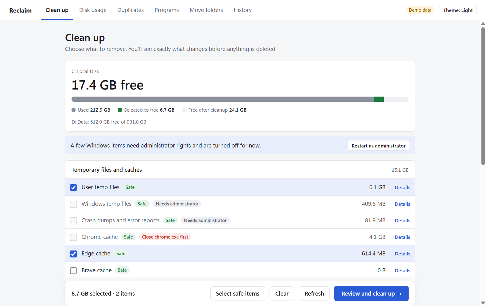
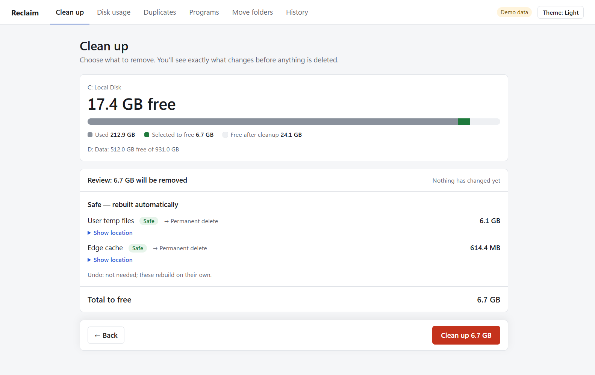
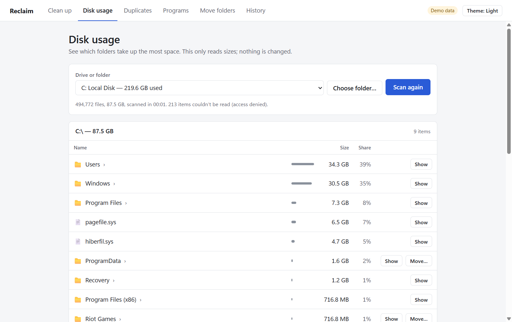
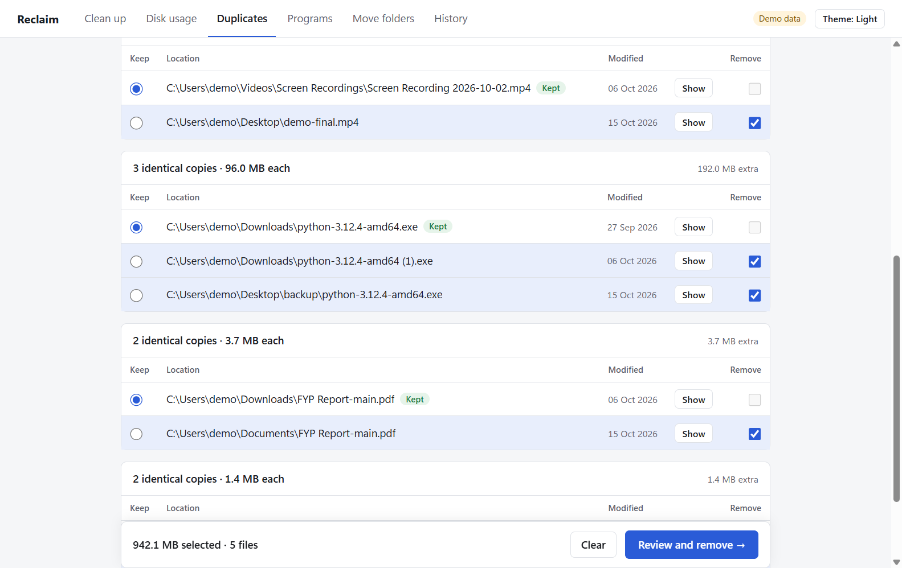
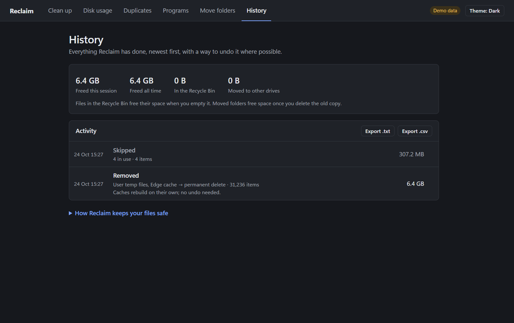

# Reclaim

**Find out what is eating your Windows drive and safely get the space back.**

Reclaim is a free Windows app that shows what's using your disk, cleans the caches that quietly grow to tens of gigabytes, moves big folders to another drive without breaking apps, and finds duplicate files. It's built around one rule: **a cleaner that breaks your PC is worse than a full disk.**

## Download

### [⬇ Download Reclaim for Windows](https://github.com/msaqibatifj/reclaim-releases/releases/latest/download/Reclaim-Setup.exe)

Installer for Windows 10 and 11 (64-bit). No administrator rights needed.

Prefer not to install? Get the **[portable version](https://github.com/msaqibatifj/reclaim-releases/releases/latest/download/Reclaim-portable.exe)** and run it from any folder. Older versions are on the [Releases](https://github.com/msaqibatifj/reclaim-releases/releases) page.

> **"Windows protected your PC"?** Reclaim isn't code-signed yet, so SmartScreen warns about it the first time. Click **More info → Run anyway**.



## What it does

| | |
|---|---|
| **Clean up** | Temp files, Windows Update leftovers, browser caches (Chrome, Edge, Brave; your logins and history stay), developer caches (npm, pip, Yarn, NuGet), game and shader caches, crash dumps, the Recycle Bin and more. Each item is labelled **Safe**, **Re-downloads** or **Check first**, and **Details** explains what it is and what happens if you remove it. |
| **Disk usage** | Every folder sized, largest first. Click into folders, see your biggest files and what kinds of files take up the most space. |
| **Duplicates** | Finds files with exactly the same contents. You choose which copy to keep; the rest go to the Recycle Bin and can be restored. |
| **Programs** | Installed programs by size, with an uninstall button that runs the program's own uninstaller. |
| **Move folders** | Moves a big folder (like a game library) to another drive and leaves a shortcut behind, so apps keep working without reinstalling. You can move it back at any time. |
| **History** | Everything Reclaim has done, with an undo where possible. |

<p>
  
  
  
  
</p>

## How it keeps your files safe

- **You always review first.** Nothing is deleted, moved or uninstalled in one click. You see exactly what will change, where it goes and how to undo it, then confirm.
- **Your personal folders are off-limits.** Documents, Desktop, Downloads, Pictures, Videos, Music, OneDrive, Windows and Program Files are never cleaned.
- **Files in use are skipped,** never forced. If an app is running, Reclaim asks you to close it first.
- **Moved folders keep their original** until you choose to delete it, and only after Reclaim checks the new location works.
- **One copy is always kept** when removing duplicates.
- **Administrator rights only when needed.** Reclaim runs as a normal user; a few Windows-level cleanups ask you to restart it as administrator.
- **Works offline.** No accounts, no ads, no telemetry, no network calls.

## Check your download (optional)

Every release includes `SHA256SUMS.txt`. To check a file, open PowerShell in your Downloads folder and run:

```powershell
Get-FileHash .\Reclaim-Setup.exe
```

The hash should match the line for `Reclaim-Setup.exe` in `SHA256SUMS.txt` (letter case doesn't matter).

## Updating and uninstalling

- **Update:** download the latest installer and run it. Your history is kept.
- **Uninstall:** Windows **Settings → Apps → Installed apps → Reclaim → Uninstall**. For the portable version, just delete the file.
- **Remove your history too:** delete the folder `%APPDATA%\Reclaim` (paste that into File Explorer's address bar).

## Questions and bug reports

Found a problem or have an idea? [Open an issue](https://github.com/msaqibatifj/reclaim-releases/issues). Please include your Windows version and what you were doing when it happened.

---

This repository hosts the downloads for Reclaim. The source code is kept in a separate repository.
